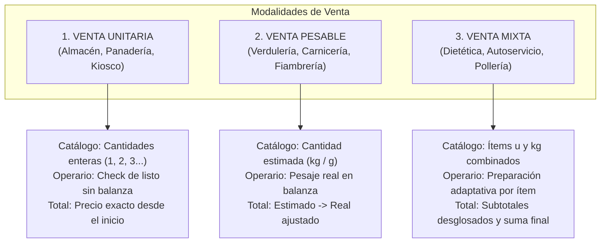

# Comparativa de Experiencia de Usuario: Nexo Pedidos vs MiHuerta

**Fecha:** 2 de noviembre de 2026  
**Documento:** `docs/UX_COMPARISON.md`  
**Paquete:** QA-A  
**Método:** Inspección estática y lectura comparativa (sin mutación ni ejecución de MiHuerta productiva).

---

## 1. Diagnóstico de la Percepción: ¿Por qué Nexo se percibía más pobre?

El relevamiento inicial del usuario señaló que *«Nexo se siente más pobre que MiHuerta»*. El análisis técnico de interfaz y recorridos confirma las siguientes razones objetivas:

| Dimensión | MiHuerta (MVP Verdulería) | Nexo Pedidos (Estado Base 47c05b3) | Diagnóstico / Regresión |
|---|---|---|---|
| **Navegación / Scroll** | Desplazamiento fluido en navegador nativo de desarrollo | Bloqueo severo de scroll en catálogo y vistas (BUG-001) por guardas `overflow-x: hidden` | **Crítica:** La imposibilidad de scrollear degradó totalmente la experiencia de uso. |
| **Dominio Comercial** | 100% enfocado en verdulería/frutería (vocabulario de balanza, pesaje, gramos) | Mantuvo el vocabulario de verdulería sin adaptarse a comercios de venta unitaria o mixta | **Inadecuación:** Un comercio unitario (panadería, almacén, tienda) se siente forzado a usar conceptos de balanza irrelevantes. |
| **Administración** | Sólo ajuste de precios sobre un listado estático prefijado | Idéntico a MiHuerta: sólo modifica precios existentes | **Insuficiencia:** Imposible para el dueño agregar un producto nuevo, cambiar su unidad o categorizarlo. |
| **Preparación en Mostrador** | Flujo pensado para pesar uno a uno cada ítem | El operario sigue exigiendo pesaje incluso para artículos que se despachan por unidad cerrada | **Fricción Operativa:** Exige pasos innecesarios para ítems no pesables. |
| **Resumen y Cierre de Pedidos** | Resumen simple con cálculo de balanza | Deuda en operario: `total_real \|\| total_estimado` falla si el total final es \$0 | **Deuda Técnica:** Falta solidez en casos de cancelación o bonificación total. |

---

## 2. Inventario Comparativo de Pantallas y Recorridos

### 2.1 Vista Cliente (Catálogo y Pedido)
- **MiHuerta:**
  - Header con identidad fija de "Mi Huerta", insignia de estado "Abierto", selector de categoría deslizable.
  - Tarjetas de producto con control de incremento (+/-) según paso (`step: 0.5` para kg, `step: 1` para unidad).
  - Botón flotante inferior con contador de ítems y subtotal estimado.
  - Carrito tipo bottom-sheet con controles directos, toggle de Retiro/Envío y botón de confirmar.
- **Nexo Pedidos:**
  - Conservó la estética visual limpia, tipografía (Plus Jakarta Sans) y esquema de colores Emerald.
  - Sumó modo oscuro accesible y banner de advertencia de Modo Demo (NP-002).
  - **Oportunidades de mejora visual para paquetes B y C:**
    - Hacer configurables el nombre del comercio, los colores de marca y el subtítulo del catálogo.
    - Clarificar visualmente en la tarjeta de producto si el precio es por **Unidad** ($/u) o por **Peso** ($/kg) con tipografía diferenciada.
    - Proporcionar feedback visual inmediato más evidente (animación o badge reactivo) al pulsar "Agregar +".

### 2.2 Vista Operario (Puesto de Preparación / Mostrador)
- **MiHuerta:**
  - Columnas Kanban: *Entrantes*, *En Balanza*, *Listos*, *Cobrados*.
  - Al abrir un pedido, pantalla de pesaje ítem por ítem con teclado numérico en pantalla.
  - Vocabulario dominante: "Pesar ítem", "Balanza", "Gramos reales".
- **Nexo Pedidos:**
  - Mantuvo la estructura de 4 estados.
  - Permite edición de entrega, faltante (marcar sin stock) y cancelación suave (`cancelOrder`).
  - **Limitación actual:** Trata todos los pedidos bajo la lógica de balanza. Si un cliente pide 3 paquetes de galletitas o 2 gaseosas, la interfaz muestra peso estimado y solicita pesaje real.

### 2.3 Vista Administración (Precios y Catálogo)
- **MiHuerta y Nexo Pedidos Actual:**
  - Listado vertical con filtros por categoría.
  - Cada fila sólo permite: toggle disponible/agotado y botones +/- para modificar el precio unitario.
  - Sin botón de "Nuevo Producto", sin edición de nombre, sin cambio de unidad, sin eliminación ni archivo.

---

## 3. Propuesta de Arquitectura UI para Modalidades de Venta (Paquete B)

Para convertir Nexo Pedidos en un producto universal adaptable a diferentes rubros, el sistema debe admitir tres modalidades operativas dentro de la misma instalación:



### Reglas de Diseño UI para Ítems Unitarios:
- **Catálogo:** Se eligen cantidades enteras (paso = 1). La etiqueta de precio indica `$X c/u` o `$X / unidad`.
- **Carrito:** Los controles +/- operan con números enteros. No se muestra la leyenda *"Total sujeto a balanza"* si todos los ítems son unitarios.
- **Preparación (Operario):** El operario visualiza la cantidad solicitada (ej. `2 u`) y un botón de un toque para confirmar *"Completado"* (o ajustar faltante si hay menos stock). **No se muestra campo de gramos ni teclado de balanza.**
- **Total:** El importe del pedido es definitivo desde que el cliente confirma, agilizando el checkout.

### Reglas de Diseño UI para Ítems Pesables:
- **Catálogo:** Se indica claramente `$X / kg` o `$X / 100g`. Los controles permiten pasos fraccionarios (`0.25`, `0.5`, `1`).
- **Carrito:** Se explicita el carácter estimado del subtotal y la leyenda de aviso de pesaje.
- **Preparación (Operario):** Se solicita el peso real en balanza y se calcula el subtotal real (`peso_real * precio_kg`).

### Resolución de la Deuda del Total Cero:
- En `store.js` y `operator.js`, el cálculo de total final no debe recurrir a la expresión `total_real || total_estimado`, porque si un pedido se ajusta a \$0 (bonificación o faltante total), JavaScript evalúa `0` como falsy y restaura erróneamente el valor estimado. Se debe validar estrictamente `typeof order.total_real === "number" ? order.total_real : order.total_estimado`.

---

## 4. Propuesta de Catálogo Administrable (CRUD) (Paquete C)

### 4.1 Entidad de Producto Configurable
Cada producto del catálogo contará con el siguiente contrato de datos extensible:
```json
{
  "id": "prod-101",
  "codigo": "ART-0101",
  "nombre": "Pan Francés",
  "categoria": "Panadería",
  "modalidad": "UNITARIO", 
  "unidad_base": "kg",
  "precio": 2400,
  "paso": 0.5,
  "disponible": true,
  "archivado": false
}
```
*Valores posibles de `modalidad`: `"UNITARIO"` | `"PESABLE"` | `"FRACCIONABLE"`.*

### 4.2 Interfaz de Gestión en Panel de Precios
1. **Acción Principal:** Botón accesible `+ Nuevo Producto` en la cabecera.
2. **Modal / Formulario de Alta y Edición:**
   - Nombre del producto (obligatorio, saneado contra XSS).
   - Categoría (selección de categorías existentes o creación de nueva).
   - Modalidad de Venta (Selector segmentado: *Por Unidad* vs *Al Peso*).
   - Precio actual y unidad de medida (`u`, `kg`, `g`, `docena`, `litro`).
   - Paso permitido (ej. `1` para unidades, `0.5` o `0.25` para pesables).
3. **Acciones por Producto:**
   - **Cambio rápido de precio:** Conservar los controles +/- actuales y permitir edición por toque numérico directo.
   - **Toggle de disponibilidad:** Activar/pausar de inmediato para sacarlo del catálogo del cliente sin borrarlo.
   - **Archivar / Desactivar:** Borrado lógico (`archivado = true`). **Nunca eliminación física (HARD DELETE)** en base de datos para no romper la integridad referencial ni corromper el historial de pedidos anteriores donde figure ese producto.

---

## 5. Relevamiento Preliminar para Importación Masiva (Paquete D)

De acuerdo con el plan de acción, antes de implementar cualquier importador definitivo, se deben relevar las siguientes características directamente con el comercio cliente:

1. **Formato y Fuente:**
   - ¿El cliente exporta desde un software de gestión (ej. Dragonfish, Tango, Lince) o gestiona manualmente en Excel / Google Sheets?
   - Formatos requeridos: CSV con separador `;` o `,`, XLSX.
2. **Estructura de Columnas Típica:**
   - Código de Barras / SKU / Código interno.
   - Descripción o Nombre del producto.
   - Rubro o Categoría.
   - Precio de venta al público (formato decimal: ¿coma o punto?).
   - ¿Indica stock actual o sólo disponibilidad?
3. **Política de Duplicados y Actualización:**
   - ¿Qué campo actúa como clave unívoca: el Código o el Nombre?
   - Si un producto ya existe: ¿se actualiza sólo el precio o se sobreescriben todos los campos?
   - ¿Qué ocurre con los productos del catálogo que no están en el nuevo archivo (se archivan, se marcan sin stock o se ignoran)?
4. **Flujo de Importación Recomendado:**
   - **Paso 1:** Cargar archivo.
   - **Paso 2:** Mapeo interactivo de columnas (asociar encabezados del archivo con los campos de Nexo).
   - **Paso 3:** Previsualización y validación (muestra filas correctas, advertencias y filas inválidas antes de escribir).
   - **Paso 4:** Confirmación y reporte resumen de altas/actualizaciones.

---
*Este inventario sirve de base contractual y de diseño para la implementación de los paquetes B y C.*
